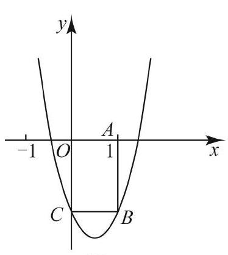
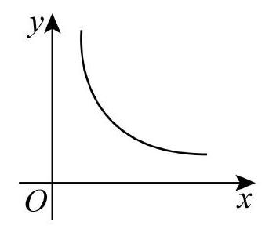

# AVP0791 — Single visual target

MV-MATH:91_1 / MV-MATH:78_1 · same type · Mathematical roles of symbols

## Shared or similar visual information

The letter x

## Evidence locations

- Left image: x next to the horizontal arrow beneath the right branch of the parabola
- Right image: x below the horizontal arrow beneath the decreasing curve

## Mathematical meanings

Left image: The symbol "x" labels the indicated coordinate axis. Right image: The symbol "x" labels the indicated coordinate axis.

## Same mathematical meanings

yes

## Rationales

The left occurrence is x next to the horizontal arrow beneath the right branch of the parabola. The right occurrence is x below the horizontal arrow beneath the decreasing curve. The placement in each image shows that the symbol labels the indicated coordinate axis.

Only the selected target is annotated. AI visual-review draft; not independently double-annotated by humans.
