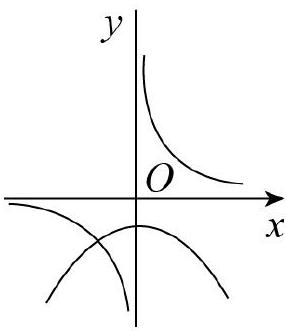
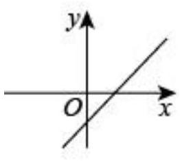

# AVP0792 — Single visual target

MV-MATH:95_1 / MV-MATH:994_1 · same type · Mathematical roles of symbols

## Shared or similar visual information

The letter x

## Evidence locations

- Left image: x at the arrow between the two right-hand plotted branches
- Right image: x beside the arrow on the horizontal axis crossing the rising line

## Mathematical meanings

Left image: The symbol "x" labels the indicated coordinate axis. Right image: The symbol "x" labels the indicated coordinate axis.

## Same mathematical meanings

yes

## Rationales

The left occurrence is x at the arrow between the two right-hand plotted branches. The right occurrence is x beside the arrow on the horizontal axis crossing the rising line. The placement in each image shows that the symbol labels the indicated coordinate axis.

Only the selected target is annotated. AI visual-review draft; not independently double-annotated by humans.
