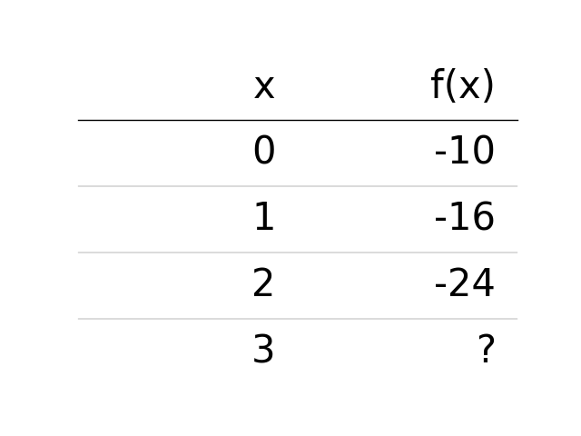
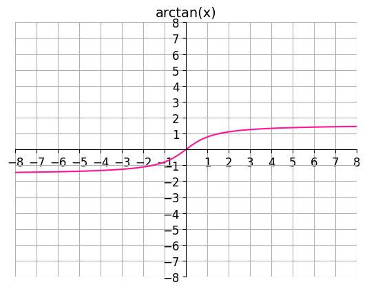

# AVP0793 — Single visual target

DynaMath:63 / DynaMath:118 · different type · Mathematical roles of symbols

## Shared or similar visual information

The letter x

## Evidence locations

- Left image: x atop the column with inputs 0 through 3
- Right image: x inside arctan(x) above the curve

## Mathematical meanings

Left image: The symbol "x" denotes the independent input to the function. Right image: The symbol "x" denotes the independent input to the function.

## Same mathematical meanings

yes

## Rationales

The left occurrence is x atop the column with inputs 0 through 3. The right occurrence is x inside arctan(x) above the curve. The placement in each image shows that the symbol denotes the independent input to the function.

Only the selected target is annotated. AI visual-review draft; not independently double-annotated by humans.
