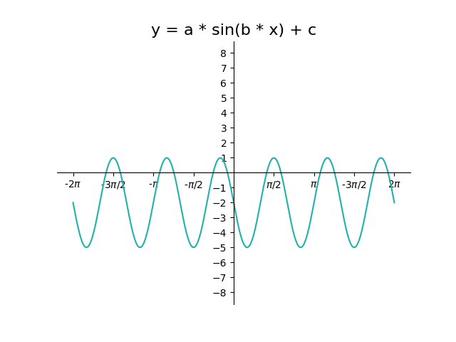
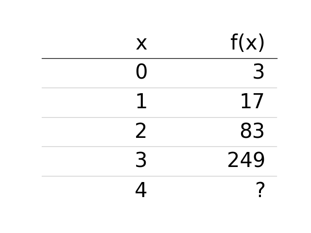

# AVP0794 — Single visual target

DynaMath:345 / DynaMath:108 · different type · Mathematical roles of symbols

## Shared or similar visual information

The letter x

## Evidence locations

- Left image: x in the sine argument in the equation above the turquoise curve
- Right image: x above the column of values from 0 to 4

## Mathematical meanings

Left image: The symbol "x" denotes the independent input to the function. Right image: The symbol "x" denotes the independent input to the function.

## Same mathematical meanings

yes

## Rationales

The left occurrence is x in the sine argument in the equation above the turquoise curve. The right occurrence is x above the column of values from 0 to 4. The placement in each image shows that the symbol denotes the independent input to the function.

Only the selected target is annotated. AI visual-review draft; not independently double-annotated by humans.
