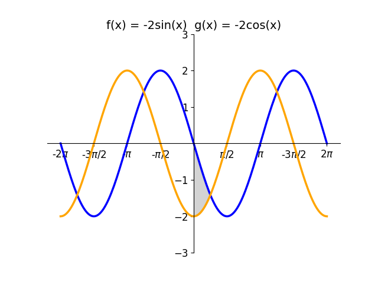
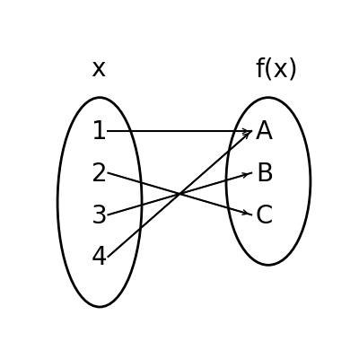

# AVP0795 — Single visual target

DynaMath:144 / DynaMath:90 · different type · Mathematical roles of symbols

## Shared or similar visual information

The letter x

## Evidence locations

- Left image: x in the sine argument in the first function definition above the graph
- Right image: x above the oval containing 1, 2, 3 and 4

## Mathematical meanings

Left image: The symbol "x" denotes the independent input to the function. Right image: The symbol "x" denotes the independent input to the function.

## Same mathematical meanings

yes

## Rationales

The left occurrence is x in the sine argument in the first function definition above the graph. The right occurrence is x above the oval containing 1, 2, 3 and 4. The placement in each image shows that the symbol denotes the independent input to the function.

Only the selected target is annotated. AI visual-review draft; not independently double-annotated by humans.
