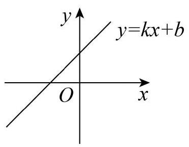
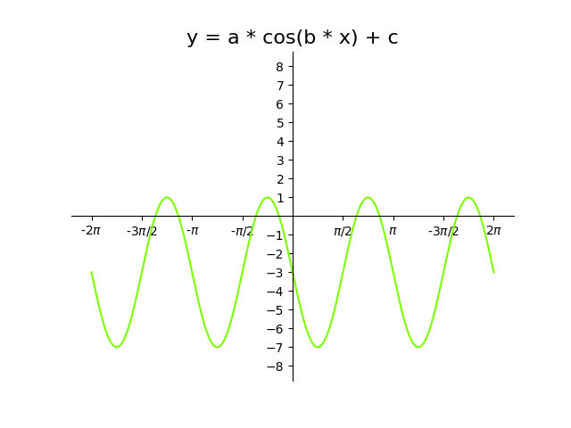

# AVP0796 — Single visual target

MV-MATH:950_1 / DynaMath:346 · same type · Mathematical roles of symbols

## Shared or similar visual information

The letter x

## Evidence locations

- Left image: x inside the term kx of the displayed straight-line equation
- Right image: x inside the cosine argument over the plotted green curve

## Mathematical meanings

Left image: The symbol "x" denotes the independent input to the function. Right image: The symbol "x" denotes the independent input to the function.

## Same mathematical meanings

yes

## Rationales

The left occurrence is x inside the term kx of the displayed straight-line equation. The right occurrence is x inside the cosine argument over the plotted green curve. The placement in each image shows that the symbol denotes the independent input to the function.

Only the selected target is annotated. AI visual-review draft; not independently double-annotated by humans.
