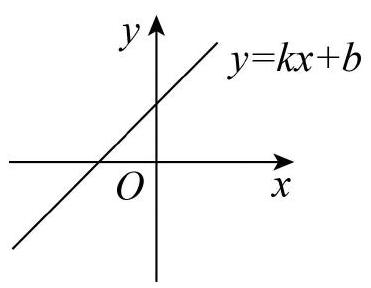
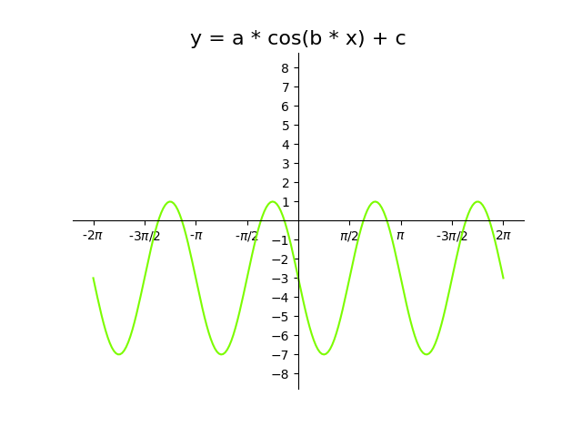

# AVP0796 — Single visual target

MV-MATH:950_1 / DynaMath:346 · same type · Mathematical roles of symbols

## Shared or similar visual information

The lowercase letter b.

## Evidence locations

- Left image: b at the final term in y = kx + b.
- Right image: b at the factor multiplying x inside the cosine argument.

## Mathematical meanings

Left image: b gives the additive constant and vertical intercept of the line (the final term in y = kx + b). Right image: b scales the input of the trigonometric function and controls the period (the factor multiplying x inside the cosine argument).

## Same mathematical meanings

no

## Rationales

On the left, b gives the additive constant and vertical intercept of the line (the final term in y = kx + b). On the right, b scales the input of the trigonometric function and controls the period (the factor multiplying x inside the cosine argument).

Only the selected target is annotated. AI visual-review draft; not independently double-annotated by humans.
