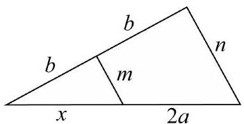
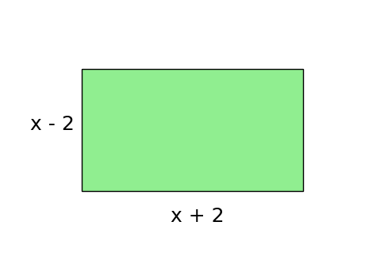

# AVP0797 — Single visual target

MV-MATH:527_1 / DynaMath:65 · same type · Mathematical roles of symbols

## Shared or similar visual information

The letter x

## Evidence locations

- Left image: x under the left part of the triangle base
- Right image: x in the expression x + 2 under the green rectangle

## Mathematical meanings

Left image: The symbol "x" denotes a length or a variable in the indicated length expression. Right image: The symbol "x" denotes a length or a variable in the indicated length expression.

## Same mathematical meanings

yes

## Rationales

The left occurrence is x under the left part of the triangle base. The right occurrence is x in the expression x + 2 under the green rectangle. The placement in each image shows that the symbol denotes a length or a variable in the indicated length expression.

Only the selected target is annotated. AI visual-review draft; not independently double-annotated by humans.
