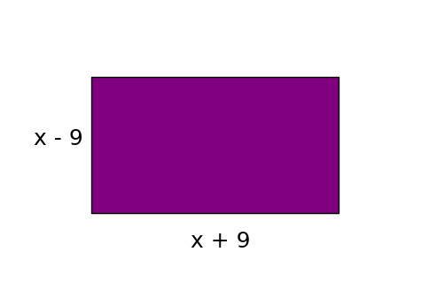
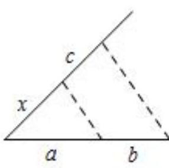

# AVP0798 — Single visual target

DynaMath:66 / MV-MATH:505_1 · same type · Mathematical roles of symbols

## Shared or similar visual information

The letter x

## Evidence locations

- Left image: x in the expression x - 9 beside the purple rectangle
- Right image: x beside the first slanted segment from the lower-left corner

## Mathematical meanings

Left image: The symbol "x" denotes a length or a variable in the indicated length expression. Right image: The symbol "x" denotes a length or a variable in the indicated length expression.

## Same mathematical meanings

yes

## Rationales

The left occurrence is x in the expression x - 9 beside the purple rectangle. The right occurrence is x beside the first slanted segment from the lower-left corner. The placement in each image shows that the symbol denotes a length or a variable in the indicated length expression.

Only the selected target is annotated. AI visual-review draft; not independently double-annotated by humans.
