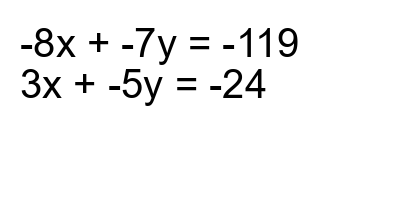
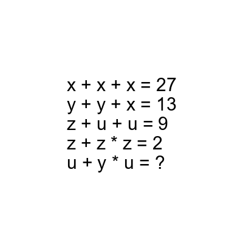

# AVP0799 — Single visual target

DynaMath:492 / DynaMath:16 · same type · Mathematical roles of symbols

## Shared or similar visual information

The letter x

## Evidence locations

- Left image: x in the leading term of each of the two simultaneous equations
- Right image: x repeated as all three addends in the first equation

## Mathematical meanings

Left image: The symbol "x" denotes one of the unknown numbers constrained by the equations. Right image: The symbol "x" denotes one of the unknown numbers constrained by the equations.

## Same mathematical meanings

yes

## Rationales

The left occurrence is x in the leading term of each of the two simultaneous equations. The right occurrence is x repeated as all three addends in the first equation. The placement in each image shows that the symbol denotes one of the unknown numbers constrained by the equations.

Only the selected target is annotated. AI visual-review draft; not independently double-annotated by humans.
