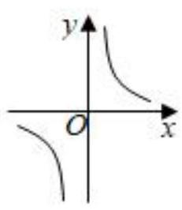
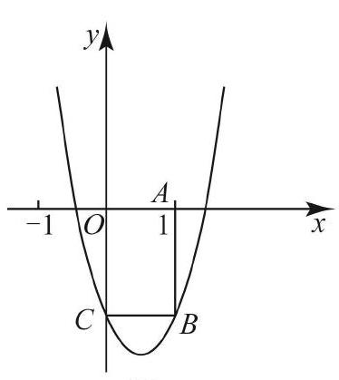

# AVP0800 — Single visual target

MV-MATH:1080_1 / MV-MATH:91_1 · same type · Mathematical roles of symbols

## Shared or similar visual information

The letter y

## Evidence locations

- Left image: y next to the upward arrow between the two branches
- Right image: y next to the upward arrow between the arms of the parabola

## Mathematical meanings

Left image: The symbol "y" labels the indicated coordinate axis. Right image: The symbol "y" labels the indicated coordinate axis.

## Same mathematical meanings

yes

## Rationales

The left occurrence is y next to the upward arrow between the two branches. The right occurrence is y next to the upward arrow between the arms of the parabola. The placement in each image shows that the symbol labels the indicated coordinate axis.

Only the selected target is annotated. AI visual-review draft; not independently double-annotated by humans.
