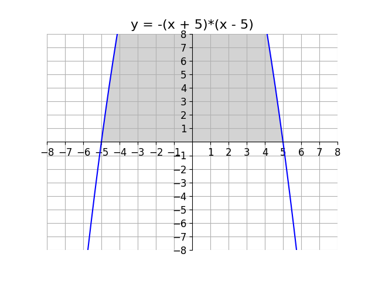
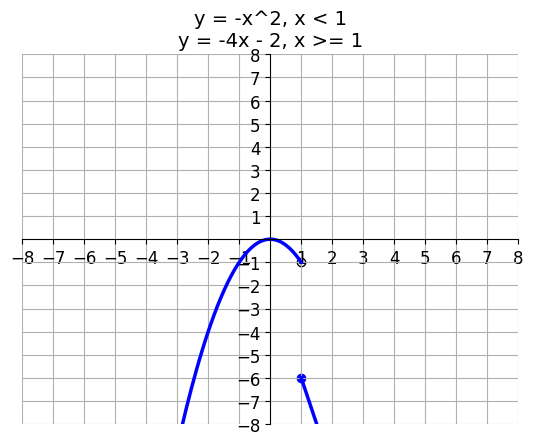

# AVP0801 — Single visual target

DynaMath:64 / DynaMath:86 · same type · Mathematical roles of symbols

## Shared or similar visual information

The letter y

## Evidence locations

- Left image: y before the equals sign in the equation above the shaded plot
- Right image: y at the start of each expression defining the two plotted branches

## Mathematical meanings

Left image: The symbol "y" denotes the dependent value defined by the displayed equation. Right image: The symbol "y" denotes the dependent value defined by the displayed equation.

## Same mathematical meanings

yes

## Rationales

The left occurrence is y before the equals sign in the equation above the shaded plot. The right occurrence is y at the start of each expression defining the two plotted branches. The placement in each image shows that the symbol denotes the dependent value defined by the displayed equation.

Only the selected target is annotated. AI visual-review draft; not independently double-annotated by humans.
