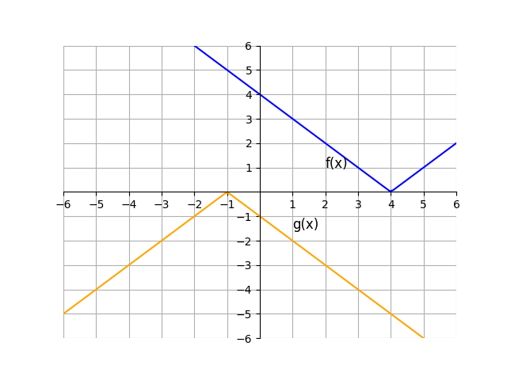
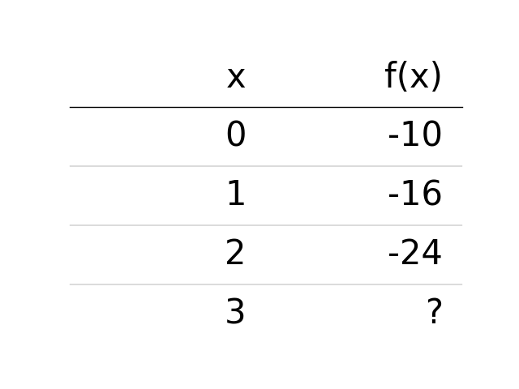

# AVP0802 — Single visual target

DynaMath:138 / DynaMath:63 · different type · Mathematical roles of symbols

## Shared or similar visual information

The notation f(x)

## Evidence locations

- Left image: f(x) adjacent to the descending part of the blue V-shaped graph
- Right image: f(x) atop the column containing -10, -16, -24 and a question mark

## Mathematical meanings

Left image: The symbol "f(x)" denotes the value of the function at input x. Right image: The symbol "f(x)" denotes the value of the function at input x.

## Same mathematical meanings

yes

## Rationales

The left occurrence is f(x) adjacent to the descending part of the blue V-shaped graph. The right occurrence is f(x) atop the column containing -10, -16, -24 and a question mark. The placement in each image shows that the symbol denotes the value of the function at input x.

Only the selected target is annotated. AI visual-review draft; not independently double-annotated by humans.
