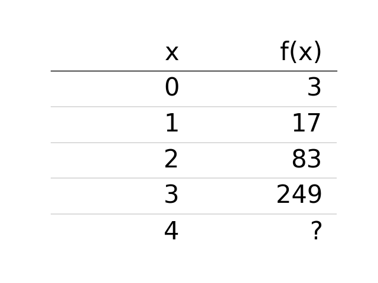
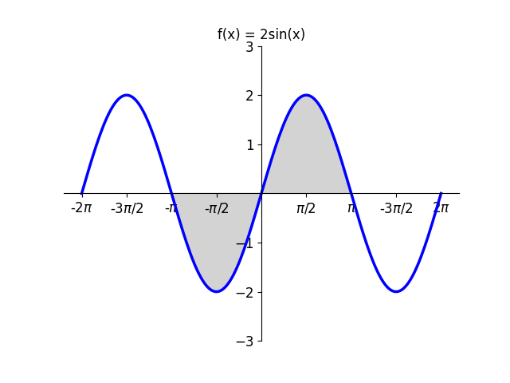

# AVP0803 — Single visual target

DynaMath:108 / DynaMath:77 · different type · Mathematical roles of symbols

## Shared or similar visual information

The notation f(x)

## Evidence locations

- Left image: f(x) atop the column containing 3, 17, 83, 249 and a question mark
- Right image: f(x) on the left side of the sine definition above the shaded curve

## Mathematical meanings

Left image: The symbol "f(x)" denotes the value of the function at input x. Right image: The symbol "f(x)" denotes the value of the function at input x.

## Same mathematical meanings

yes

## Rationales

The left occurrence is f(x) atop the column containing 3, 17, 83, 249 and a question mark. The right occurrence is f(x) on the left side of the sine definition above the shaded curve. The placement in each image shows that the symbol denotes the value of the function at input x.

Only the selected target is annotated. AI visual-review draft; not independently double-annotated by humans.
