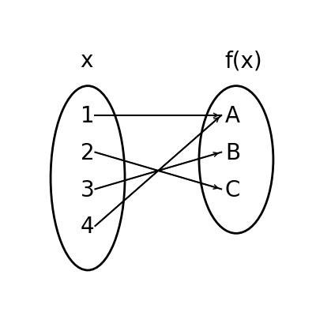
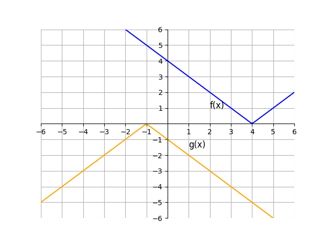

# AVP0805 — Single visual target

DynaMath:90 / DynaMath:138 · different type · Mathematical roles of symbols

## Shared or similar visual information

The notation f(x)

## Evidence locations

- Left image: f(x) above the target oval of the arrows from the four inputs
- Right image: f(x) adjacent to the descending part of the blue V-shaped graph

## Mathematical meanings

Left image: The symbol "f(x)" denotes the value of the function at input x. Right image: The symbol "f(x)" denotes the value of the function at input x.

## Same mathematical meanings

yes

## Rationales

The left occurrence is f(x) above the target oval of the arrows from the four inputs. The right occurrence is f(x) adjacent to the descending part of the blue V-shaped graph. The placement in each image shows that the symbol denotes the value of the function at input x.

Only the selected target is annotated. AI visual-review draft; not independently double-annotated by humans.
