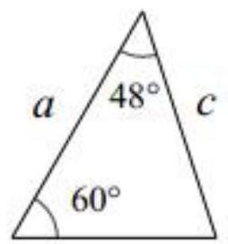
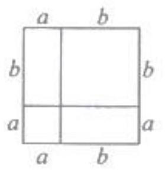

# AVP0806 — Single visual target

MV-MATH:973_1 / MV-MATH:68_1 · same type · Mathematical roles of symbols

## Shared or similar visual information

The letter a

## Evidence locations

- Left image: a beside the left side of the triangle
- Right image: a above the shorter left part of the top edge

## Mathematical meanings

Left image: The symbol "a" denotes a length or a variable in the indicated length expression. Right image: The symbol "a" denotes a length or a variable in the indicated length expression.

## Same mathematical meanings

yes

## Rationales

The left occurrence is a beside the left side of the triangle. The right occurrence is a above the shorter left part of the top edge. The placement in each image shows that the symbol denotes a length or a variable in the indicated length expression.

Only the selected target is annotated. AI visual-review draft; not independently double-annotated by humans.
