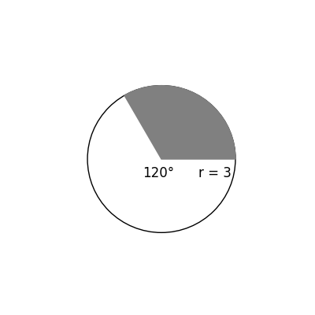
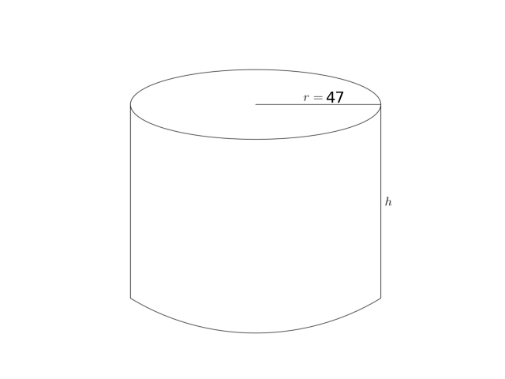

# AVP0807 — Single visual target

DynaMath:26 / DynaMath:359 · different type · Mathematical roles of symbols

## Shared or similar visual information

The letter r

## Evidence locations

- Left image: r in r = 3 beside the horizontal sector radius
- Right image: r in r = 47 along the segment on the cylinder top

## Mathematical meanings

Left image: The symbol "r" denotes the radius of the indicated circle or circular face. Right image: The symbol "r" denotes the radius of the indicated circle or circular face.

## Same mathematical meanings

yes

## Rationales

The left occurrence is r in r = 3 beside the horizontal sector radius. The right occurrence is r in r = 47 along the segment on the cylinder top. The placement in each image shows that the symbol denotes the radius of the indicated circle or circular face.

Only the selected target is annotated. AI visual-review draft; not independently double-annotated by humans.
