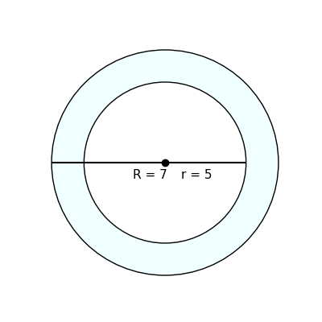
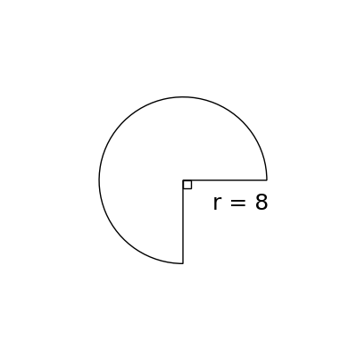

# AVP0808 — Single visual target

DynaMath:53 / DynaMath:27 · same type · Mathematical roles of symbols

## Shared or similar visual information

The letter r

## Evidence locations

- Left image: lowercase r in r = 5 beside the inner-circle radius
- Right image: r in r = 8 below the horizontal radius

## Mathematical meanings

Left image: The symbol "r" denotes the radius of the indicated circle or circular face. Right image: The symbol "r" denotes the radius of the indicated circle or circular face.

## Same mathematical meanings

yes

## Rationales

The left occurrence is lowercase r in r = 5 beside the inner-circle radius. The right occurrence is r in r = 8 below the horizontal radius. The placement in each image shows that the symbol denotes the radius of the indicated circle or circular face.

Only the selected target is annotated. AI visual-review draft; not independently double-annotated by humans.
