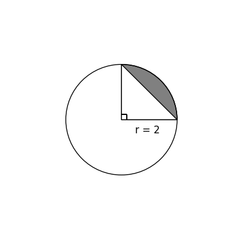
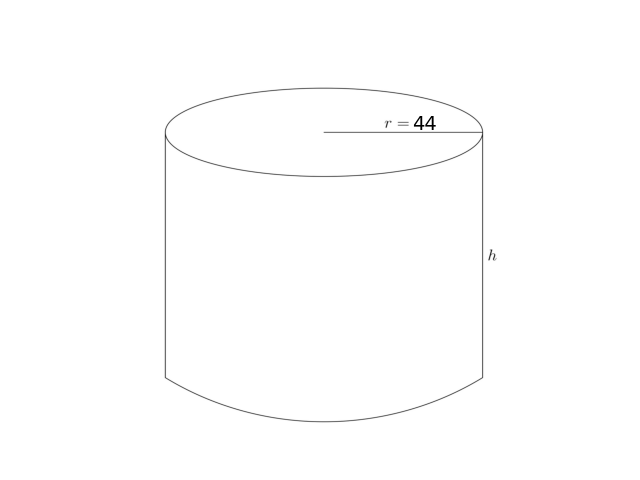

# AVP0809 — Single visual target

DynaMath:97 / DynaMath:360 · different type · Mathematical roles of symbols

## Shared or similar visual information

The letter r

## Evidence locations

- Left image: r in r = 2 beside the horizontal segment from the center
- Right image: r in r = 44 on the top circular face

## Mathematical meanings

Left image: The symbol "r" denotes the radius of the indicated circle or circular face. Right image: The symbol "r" denotes the radius of the indicated circle or circular face.

## Same mathematical meanings

yes

## Rationales

The left occurrence is r in r = 2 beside the horizontal segment from the center. The right occurrence is r in r = 44 on the top circular face. The placement in each image shows that the symbol denotes the radius of the indicated circle or circular face.

Only the selected target is annotated. AI visual-review draft; not independently double-annotated by humans.
