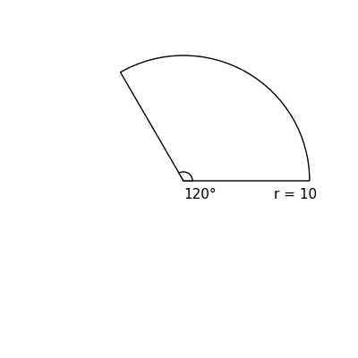
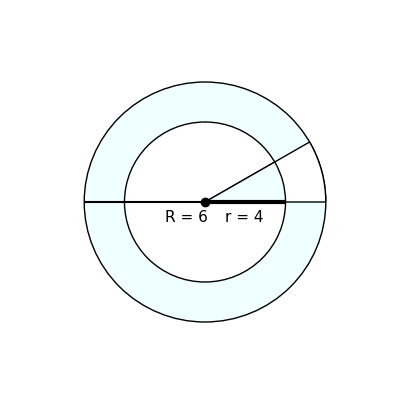

# AVP0810 — Single visual target

DynaMath:123 / DynaMath:113 · same type · Mathematical roles of symbols

## Shared or similar visual information

The letter r

## Evidence locations

- Left image: r in r = 10 below the right portion of the sector's straight edge
- Right image: lowercase r in r = 4 below the horizontal inner radius

## Mathematical meanings

Left image: The symbol "r" denotes the radius of the indicated circle or circular face. Right image: The symbol "r" denotes the radius of the indicated circle or circular face.

## Same mathematical meanings

yes

## Rationales

The left occurrence is r in r = 10 below the right portion of the sector's straight edge. The right occurrence is lowercase r in r = 4 below the horizontal inner radius. The placement in each image shows that the symbol denotes the radius of the indicated circle or circular face.

Only the selected target is annotated. AI visual-review draft; not independently double-annotated by humans.
