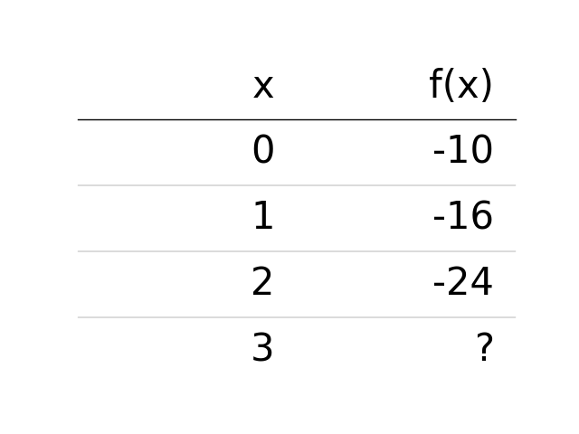
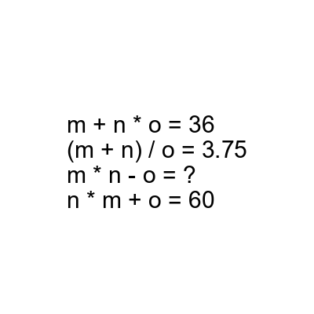

# AVP0811 — Single visual target

DynaMath:63 / DynaMath:498 · different type · Mathematical roles of symbols

## Shared or similar visual information

The question mark (?)

## Evidence locations

- Left image: ? in the f(x) column on the row for x = 3
- Right image: ? after the equals sign in m * n - o = ?

## Mathematical meanings

Left image: The symbol "?" stands for the missing numerical output or result. Right image: The symbol "?" stands for the missing numerical output or result.

## Same mathematical meanings

yes

## Rationales

The left occurrence is ? in the f(x) column on the row for x = 3. The right occurrence is ? after the equals sign in m * n - o = ?. The placement in each image shows that the symbol stands for the missing numerical output or result.

Only the selected target is annotated. AI visual-review draft; not independently double-annotated by humans.
