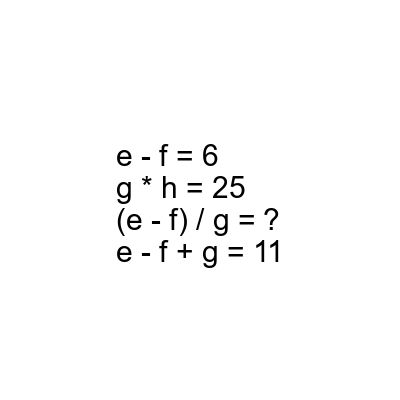
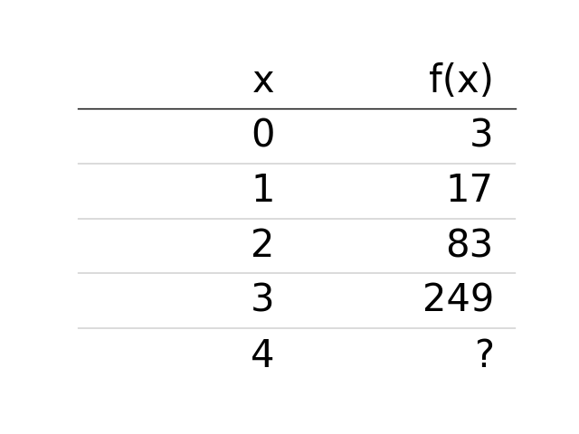

# AVP0812 — Single visual target

DynaMath:496 / DynaMath:108 · different type · Mathematical roles of symbols

## Shared or similar visual information

The question mark (?)

## Evidence locations

- Left image: ? after the equals sign on the line with (e - f) / g
- Right image: ? in the last output cell, corresponding to x = 4

## Mathematical meanings

Left image: The symbol "?" stands for the missing numerical output or result. Right image: The symbol "?" stands for the missing numerical output or result.

## Same mathematical meanings

yes

## Rationales

The left occurrence is ? after the equals sign on the line with (e - f) / g. The right occurrence is ? in the last output cell, corresponding to x = 4. The placement in each image shows that the symbol stands for the missing numerical output or result.

Only the selected target is annotated. AI visual-review draft; not independently double-annotated by humans.
