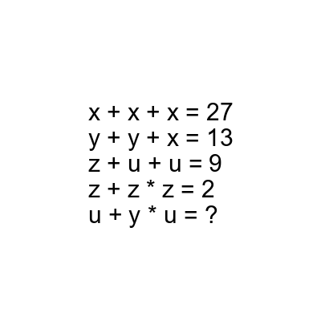
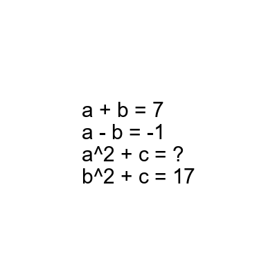

# AVP0813 — Single visual target

DynaMath:16 / DynaMath:499 · same type · Mathematical roles of symbols

## Shared or similar visual information

The question mark (?)

## Evidence locations

- Left image: ? to the right of u + y * u =
- Right image: ? after the equals sign in the equation containing a squared

## Mathematical meanings

Left image: The symbol "?" stands for the missing numerical output or result. Right image: The symbol "?" stands for the missing numerical output or result.

## Same mathematical meanings

yes

## Rationales

The left occurrence is ? to the right of u + y * u =. The right occurrence is ? after the equals sign in the equation containing a squared. The placement in each image shows that the symbol stands for the missing numerical output or result.

Only the selected target is annotated. AI visual-review draft; not independently double-annotated by humans.
