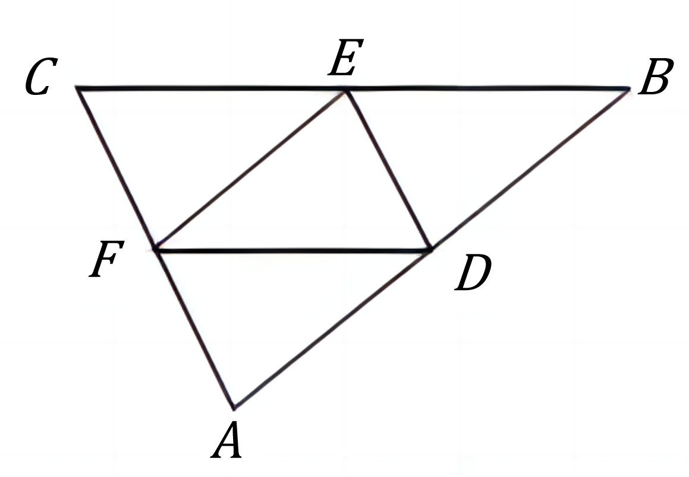
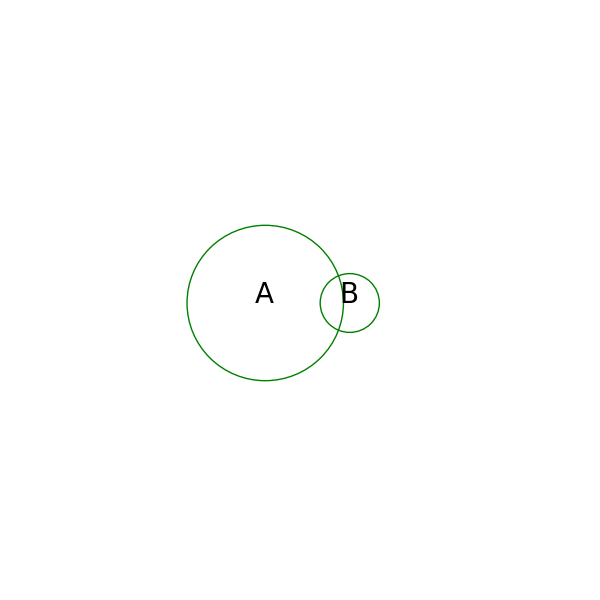

# AVP0814 — Single visual target

DynaMath:24 / DynaMath:121 · different type · Mathematical roles of symbols

## Shared or similar visual information

The letter A

## Evidence locations

- Left image: A at the bottom vertex of the large triangle
- Right image: A centered inside the larger green set circle

## Mathematical meanings

Left image: The symbol "A" names a specific geometric point at the indicated location. Right image: The symbol "A" names the set represented by the indicated circle.

## Same mathematical meanings

no

## Rationales

The left occurrence is A at the bottom vertex of the large triangle. The right occurrence is A centered inside the larger green set circle. The left placement shows that the symbol names a specific geometric point at the indicated location, while the right placement shows that it names the set represented by the indicated circle.

Only the selected target is annotated. AI visual-review draft; not independently double-annotated by humans.
