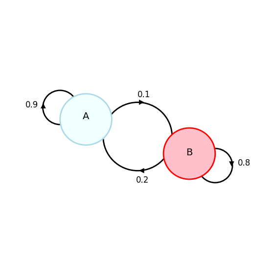
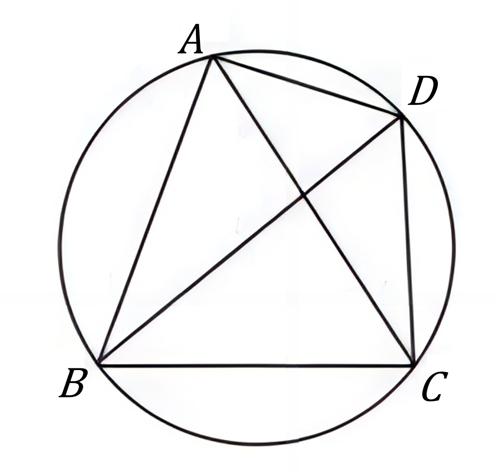

# AVP0815 — Single visual target

DynaMath:72 / DynaMath:32 · different type · Mathematical roles of symbols

## Shared or similar visual information

The letter A

## Evidence locations

- Left image: A inside the blue node with a self-loop labeled 0.9
- Right image: A at the top vertex of the inscribed quadrilateral

## Mathematical meanings

Left image: The symbol "A" names a state with directed probability transitions. Right image: The symbol "A" names a specific geometric point at the indicated location.

## Same mathematical meanings

no

## Rationales

The left occurrence is A inside the blue node with a self-loop labeled 0.9. The right occurrence is A at the top vertex of the inscribed quadrilateral. The left placement shows that the symbol names a state with directed probability transitions, while the right placement shows that it names a specific geometric point at the indicated location.

Only the selected target is annotated. AI visual-review draft; not independently double-annotated by humans.
