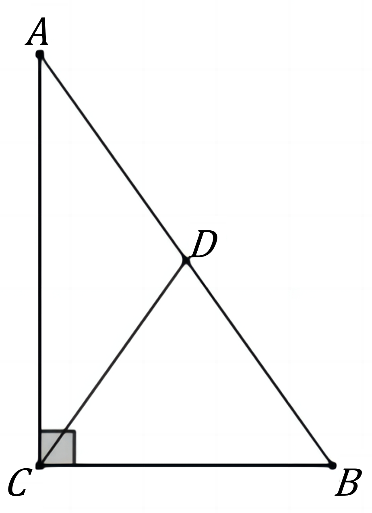
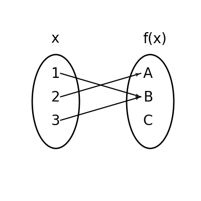

# AVP0816 — Single visual target

DynaMath:38 / DynaMath:89 · different type · Mathematical roles of symbols

## Shared or similar visual information

The letter A

## Evidence locations

- Left image: A above the upper endpoint of AC
- Right image: A at the top of the output oval, where the arrow from 2 ends

## Mathematical meanings

Left image: The symbol "A" names a specific geometric point at the indicated location. Right image: The symbol "A" names the output element reached by the indicated input arrows.

## Same mathematical meanings

no

## Rationales

The left occurrence is A above the upper endpoint of AC. The right occurrence is A at the top of the output oval, where the arrow from 2 ends. The left placement shows that the symbol names a specific geometric point at the indicated location, while the right placement shows that it names the output element reached by the indicated input arrows.

Only the selected target is annotated. AI visual-review draft; not independently double-annotated by humans.
