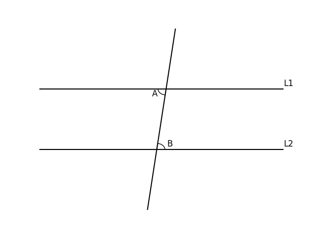
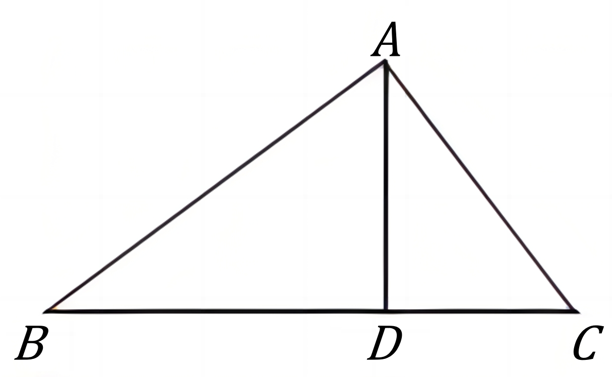

# AVP0817 — Single visual target

DynaMath:181 / DynaMath:45 · same type · Mathematical roles of symbols

## Shared or similar visual information

The letter A

## Evidence locations

- Left image: A beside the lower-left arc at the top crossing
- Right image: A at the apex above segment AD

## Mathematical meanings

Left image: The symbol "A" names the angle singled out by the arc. Right image: The symbol "A" names a specific geometric point at the indicated location.

## Same mathematical meanings

no

## Rationales

The left occurrence is A beside the lower-left arc at the top crossing. The right occurrence is A at the apex above segment AD. The left placement shows that the symbol names the angle singled out by the arc, while the right placement shows that it names a specific geometric point at the indicated location.

Only the selected target is annotated. AI visual-review draft; not independently double-annotated by humans.
