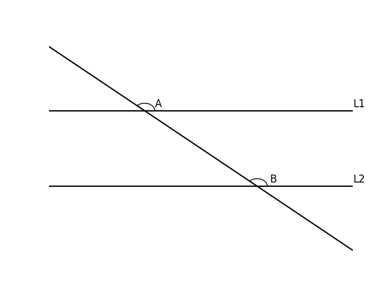

# AVP0818 — Single visual target

DynaMath:183 / DynaMath:55 · same type · Mathematical roles of symbols

## Shared or similar visual information

The letter A

## Evidence locations

- Left image: A beside the arc above the upper horizontal line
- Right image: A at the left intersection of the circle and horizontal axis

## Mathematical meanings

Left image: The symbol "A" names the angle singled out by the arc. Right image: The symbol "A" names a specific geometric point at the indicated location.

## Same mathematical meanings

no

## Rationales

The left occurrence is A beside the arc above the upper horizontal line. The right occurrence is A at the left intersection of the circle and horizontal axis. The left placement shows that the symbol names the angle singled out by the arc, while the right placement shows that it names a specific geometric point at the indicated location.

Only the selected target is annotated. AI visual-review draft; not independently double-annotated by humans.
