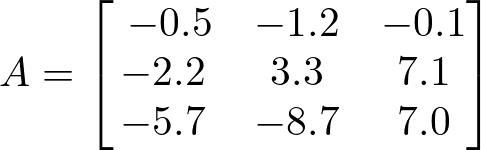
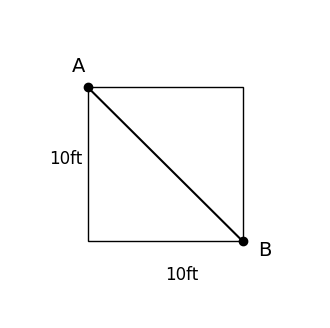

# AVP0819 — Single visual target

DynaMath:474 / DynaMath:80 · different type · Mathematical roles of symbols

## Shared or similar visual information

The letter A

## Evidence locations

- Left image: A before the equals sign and the 3 by 3 array beginning with -0.5
- Right image: A beside the dot at the upper-left square corner

## Mathematical meanings

Left image: The symbol "A" names the matrix whose entries follow in brackets. Right image: The symbol "A" names a specific geometric point at the indicated location.

## Same mathematical meanings

no

## Rationales

The left occurrence is A before the equals sign and the 3 by 3 array beginning with -0.5. The right occurrence is A beside the dot at the upper-left square corner. The left placement shows that the symbol names the matrix whose entries follow in brackets, while the right placement shows that it names a specific geometric point at the indicated location.

Only the selected target is annotated. AI visual-review draft; not independently double-annotated by humans.
