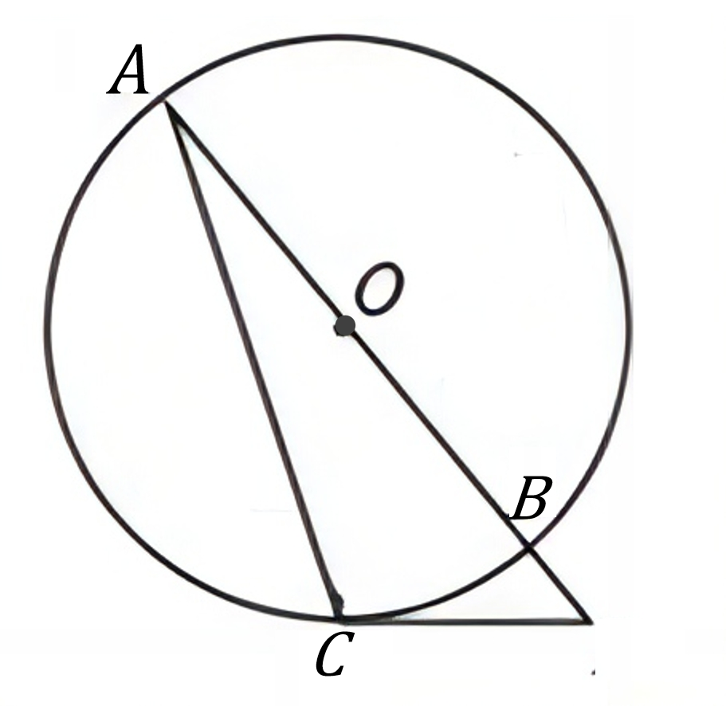
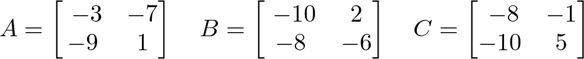

# AVP0820 — Single visual target

DynaMath:81 / DynaMath:490 · different type · Mathematical roles of symbols

## Shared or similar visual information

The letter A

## Evidence locations

- Left image: A at the upper endpoint of the line through O
- Right image: A before the first array, whose first row is -3, -7

## Mathematical meanings

Left image: The symbol "A" names a specific geometric point at the indicated location. Right image: The symbol "A" names the matrix whose entries follow in brackets.

## Same mathematical meanings

no

## Rationales

The left occurrence is A at the upper endpoint of the line through O. The right occurrence is A before the first array, whose first row is -3, -7. The left placement shows that the symbol names a specific geometric point at the indicated location, while the right placement shows that it names the matrix whose entries follow in brackets.

Only the selected target is annotated. AI visual-review draft; not independently double-annotated by humans.
