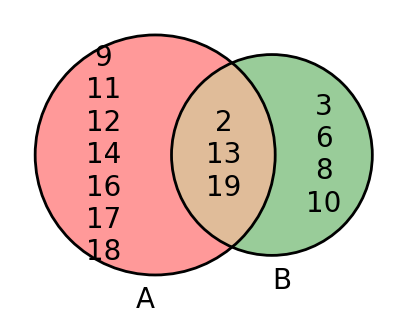
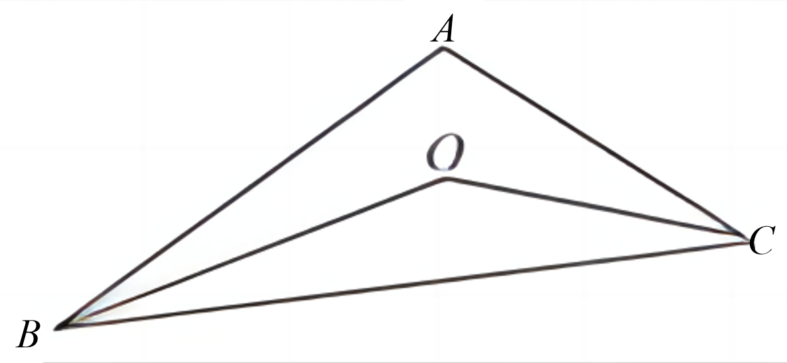

# AVP0821 — Single visual target

DynaMath:469 / DynaMath:93 · different type · Mathematical roles of symbols

## Shared or similar visual information

The letter A

## Evidence locations

- Left image: A below the left circle with 9 at its upper edge
- Right image: A at the top vertex of the outer triangle

## Mathematical meanings

Left image: The symbol "A" names the set represented by the indicated circle. Right image: The symbol "A" names a specific geometric point at the indicated location.

## Same mathematical meanings

no

## Rationales

The left occurrence is A below the left circle with 9 at its upper edge. The right occurrence is A at the top vertex of the outer triangle. The left placement shows that the symbol names the set represented by the indicated circle, while the right placement shows that it names a specific geometric point at the indicated location.

Only the selected target is annotated. AI visual-review draft; not independently double-annotated by humans.
