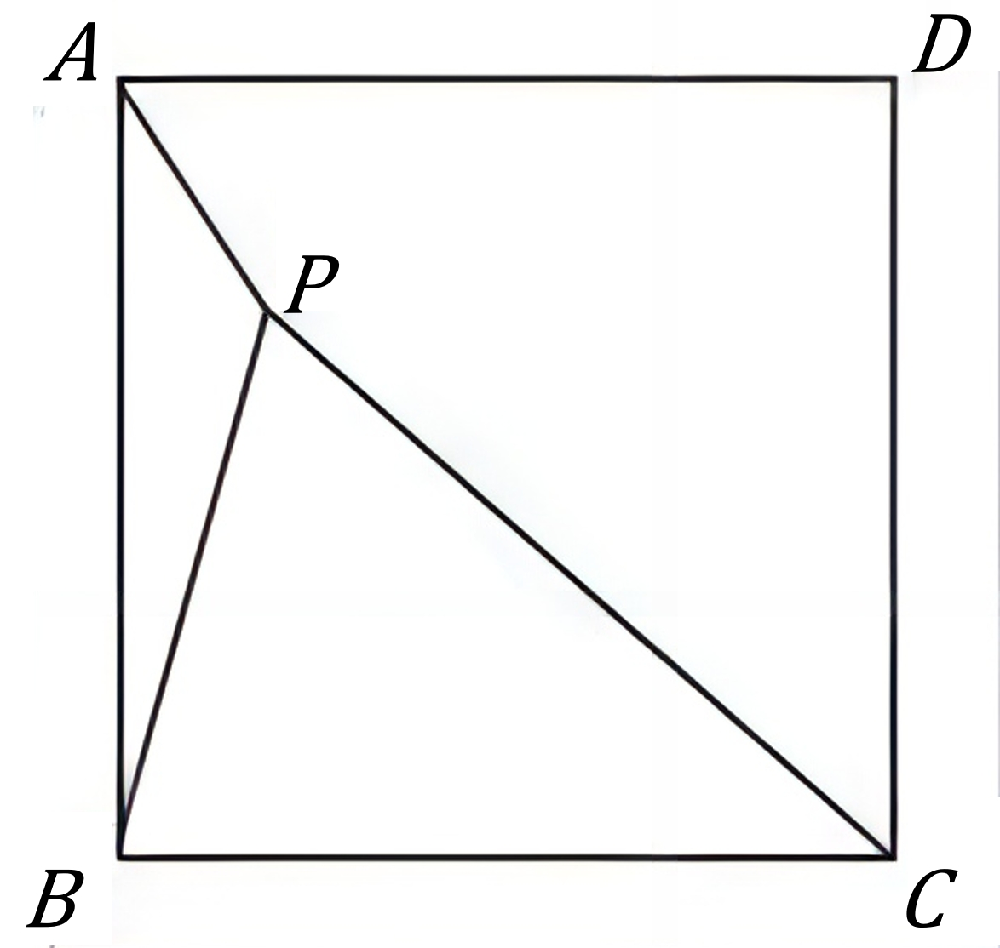
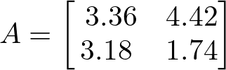

# AVP0822 — Single visual target

DynaMath:145 / DynaMath:481 · different type · Mathematical roles of symbols

## Shared or similar visual information

The letter A

## Evidence locations

- Left image: A at the upper-left endpoint of diagonal AC
- Right image: A before the 2 by 2 array beginning with 3.36

## Mathematical meanings

Left image: The symbol "A" names a specific geometric point at the indicated location. Right image: The symbol "A" names the matrix whose entries follow in brackets.

## Same mathematical meanings

no

## Rationales

The left occurrence is A at the upper-left endpoint of diagonal AC. The right occurrence is A before the 2 by 2 array beginning with 3.36. The left placement shows that the symbol names a specific geometric point at the indicated location, while the right placement shows that it names the matrix whose entries follow in brackets.

Only the selected target is annotated. AI visual-review draft; not independently double-annotated by humans.
