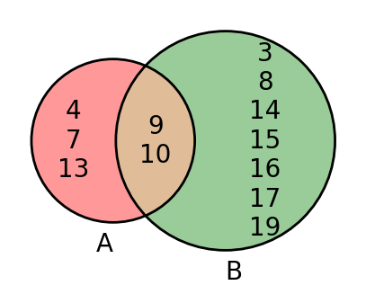
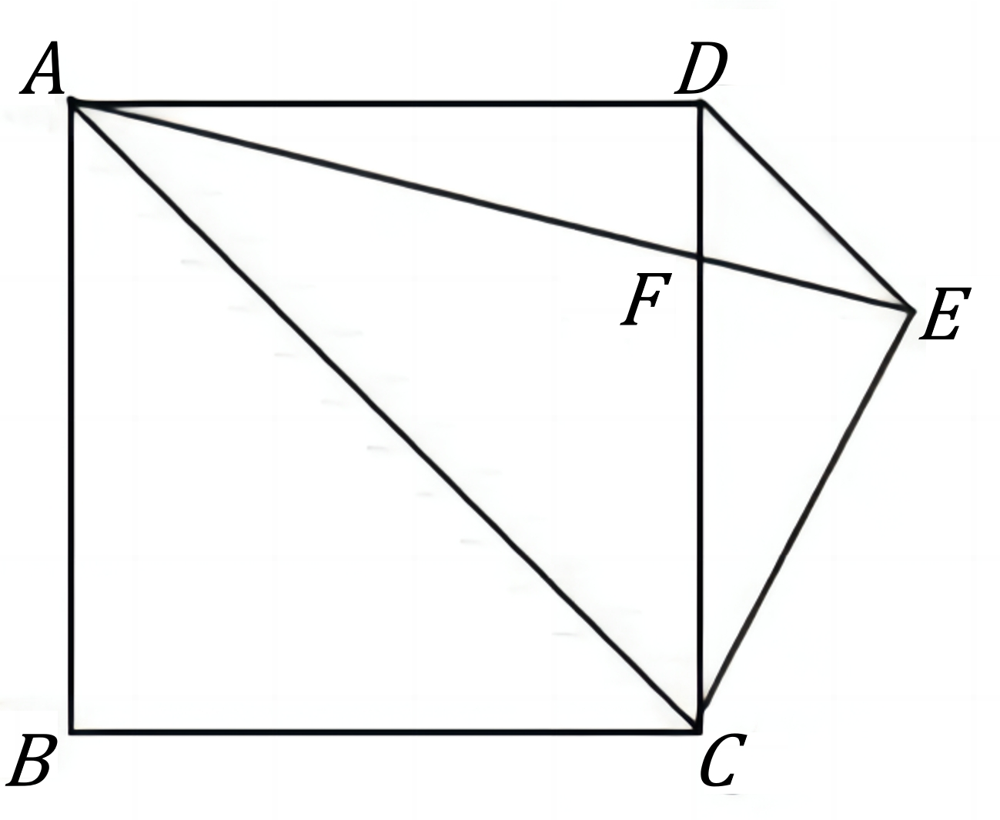

# AVP0823 — Single visual target

DynaMath:473 / DynaMath:167 · different type · Mathematical roles of symbols

## Shared or similar visual information

The letter A

## Evidence locations

- Left image: A below the red circle with 4, 8 and 13 on its left-only side
- Right image: A at the common endpoint of the three slanted segments

## Mathematical meanings

Left image: The symbol "A" names the set represented by the indicated circle. Right image: The symbol "A" names a specific geometric point at the indicated location.

## Same mathematical meanings

no

## Rationales

The left occurrence is A below the red circle with 4, 8 and 13 on its left-only side. The right occurrence is A at the common endpoint of the three slanted segments. The left placement shows that the symbol names the set represented by the indicated circle, while the right placement shows that it names a specific geometric point at the indicated location.

Only the selected target is annotated. AI visual-review draft; not independently double-annotated by humans.
