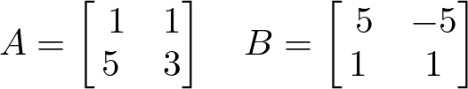
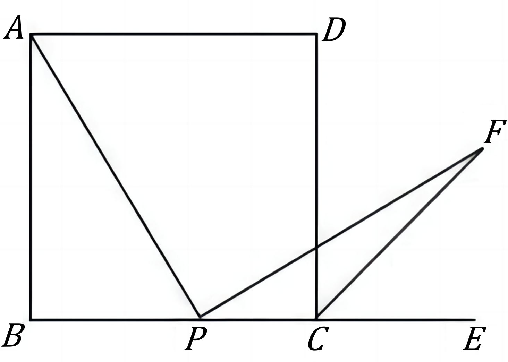

# AVP0825 — Single visual target

DynaMath:485 / DynaMath:195 · different type · Mathematical roles of symbols

## Shared or similar visual information

The letter A

## Evidence locations

- Left image: A before the array with rows (1, 1) and (5, 3)
- Right image: A at the upper-left endpoint of segment AP

## Mathematical meanings

Left image: The symbol "A" names the matrix whose entries follow in brackets. Right image: The symbol "A" names a specific geometric point at the indicated location.

## Same mathematical meanings

no

## Rationales

The left occurrence is A before the array with rows (1, 1) and (5, 3). The right occurrence is A at the upper-left endpoint of segment AP. The left placement shows that the symbol names the matrix whose entries follow in brackets, while the right placement shows that it names a specific geometric point at the indicated location.

Only the selected target is annotated. AI visual-review draft; not independently double-annotated by humans.
