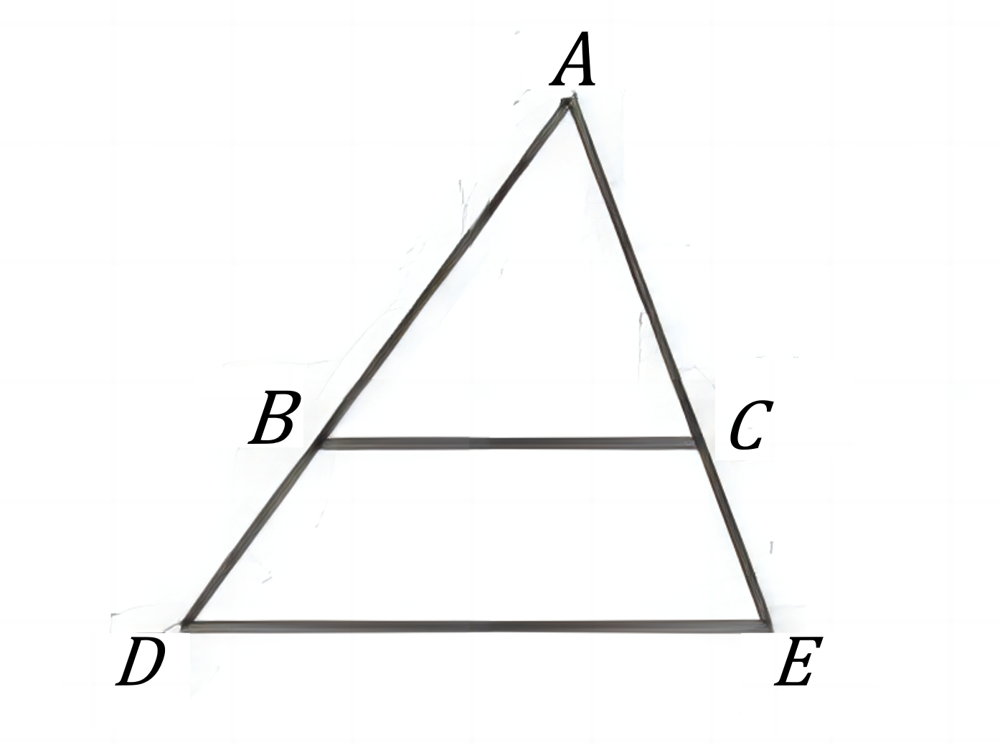
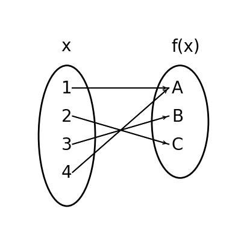

# AVP0826 — Single visual target

DynaMath:200 / DynaMath:90 · different type · Mathematical roles of symbols

## Shared or similar visual information

The letter A

## Evidence locations

- Left image: A at the apex above the two horizontal segments
- Right image: A at the top of the output oval, with incoming arrows from 1 and 4

## Mathematical meanings

Left image: The symbol "A" names a specific geometric point at the indicated location. Right image: The symbol "A" names the output element reached by the indicated input arrows.

## Same mathematical meanings

no

## Rationales

The left occurrence is A at the apex above the two horizontal segments. The right occurrence is A at the top of the output oval, with incoming arrows from 1 and 4. The left placement shows that the symbol names a specific geometric point at the indicated location, while the right placement shows that it names the output element reached by the indicated input arrows.

Only the selected target is annotated. AI visual-review draft; not independently double-annotated by humans.
