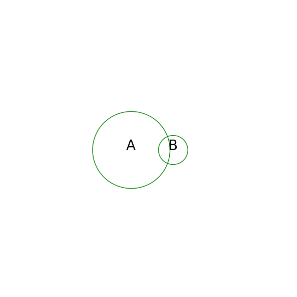
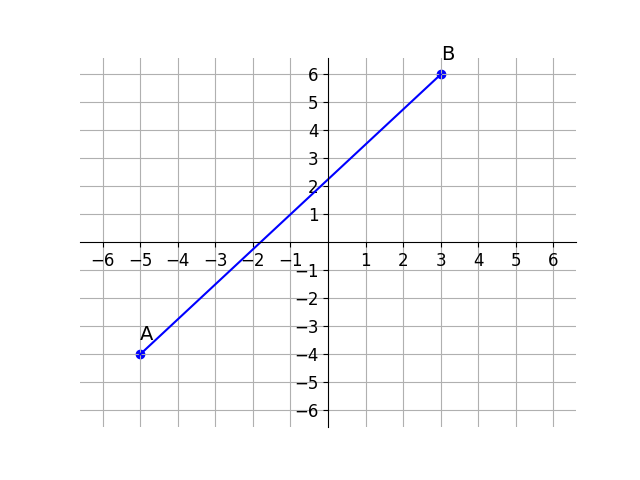

# AVP0830 — Single visual target

DynaMath:121 / DynaMath:135 · different type · Mathematical roles of symbols

## Shared or similar visual information

The letter A

## Evidence locations

- Left image: A centered inside the larger green set circle
- Right image: A beside the lower-left endpoint of the plotted line segment

## Mathematical meanings

Left image: The symbol "A" names the set represented by the indicated circle. Right image: The symbol "A" names a specific geometric point at the indicated location.

## Same mathematical meanings

no

## Rationales

The left occurrence is A centered inside the larger green set circle. The right occurrence is A beside the lower-left endpoint of the plotted line segment. The left placement shows that the symbol names the set represented by the indicated circle, while the right placement shows that it names a specific geometric point at the indicated location.

Only the selected target is annotated. AI visual-review draft; not independently double-annotated by humans.
