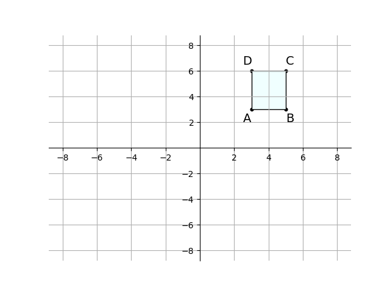
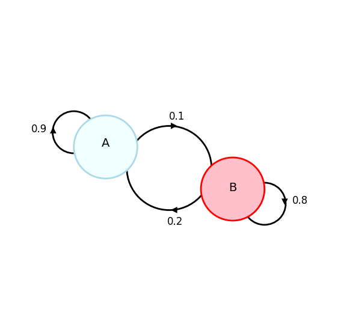

# AVP0831 — Single visual target

DynaMath:139 / DynaMath:72 · different type · Mathematical roles of symbols

## Shared or similar visual information

The letter A

## Evidence locations

- Left image: A beside the lower-left vertex of the shaded square on the coordinate plane
- Right image: A inside the blue node with a self-loop labeled 0.9

## Mathematical meanings

Left image: The symbol "A" names a specific geometric point at the indicated location. Right image: The symbol "A" names a state with directed probability transitions.

## Same mathematical meanings

no

## Rationales

The left occurrence is A beside the lower-left vertex of the shaded square on the coordinate plane. The right occurrence is A inside the blue node with a self-loop labeled 0.9. The left placement shows that the symbol names a specific geometric point at the indicated location, while the right placement shows that it names a state with directed probability transitions.

Only the selected target is annotated. AI visual-review draft; not independently double-annotated by humans.
