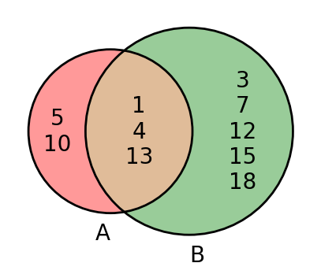
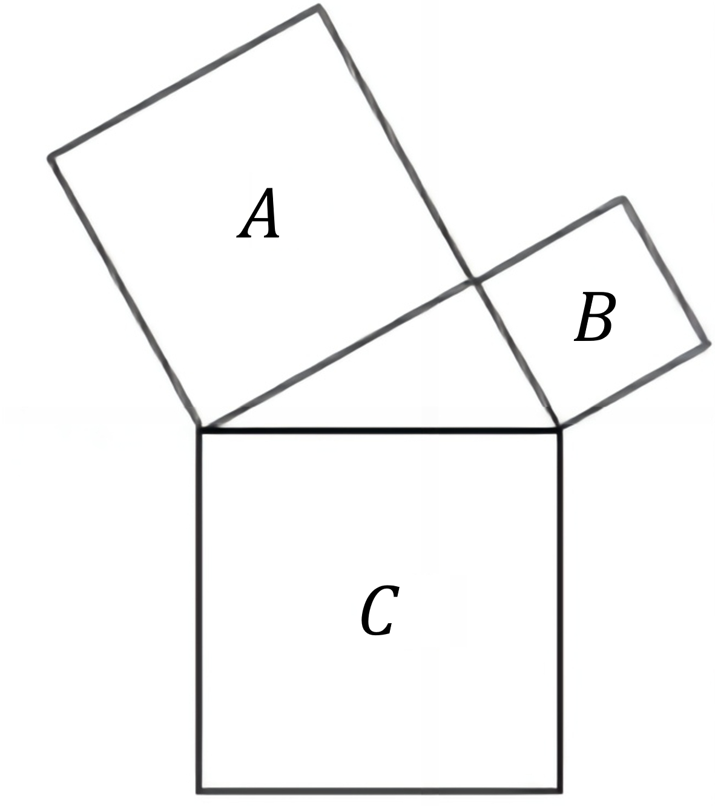

# AVP0832 — Single visual target

DynaMath:468 / DynaMath:85 · different type · Mathematical roles of symbols

## Shared or similar visual information

The letter A

## Evidence locations

- Left image: A below the left circle listing elements 5 and 10 in its exclusive region
- Right image: A inside the large tilted square built on a triangle side

## Mathematical meanings

Left image: The symbol "A" names the set represented by the indicated circle. Right image: The symbol "A" names the indicated square region.

## Same mathematical meanings

no

## Rationales

The left occurrence is A below the left circle listing elements 5 and 10 in its exclusive region. The right occurrence is A inside the large tilted square built on a triangle side. The left placement shows that the symbol names the set represented by the indicated circle, while the right placement shows that it names the indicated square region.

Only the selected target is annotated. AI visual-review draft; not independently double-annotated by humans.
