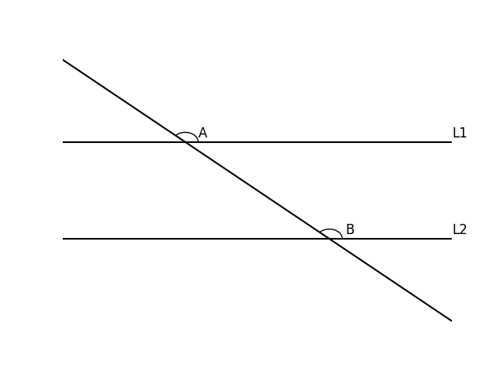
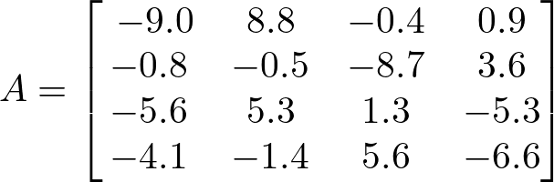

# AVP0833 — Single visual target

DynaMath:183 / DynaMath:477 · different type · Mathematical roles of symbols

## Shared or similar visual information

The letter A

## Evidence locations

- Left image: A beside the arc above the upper horizontal line
- Right image: A before the 4 by 4 array beginning with -9.0

## Mathematical meanings

Left image: The symbol "A" names the angle singled out by the arc. Right image: The symbol "A" names the matrix whose entries follow in brackets.

## Same mathematical meanings

no

## Rationales

The left occurrence is A beside the arc above the upper horizontal line. The right occurrence is A before the 4 by 4 array beginning with -9.0. The left placement shows that the symbol names the angle singled out by the arc, while the right placement shows that it names the matrix whose entries follow in brackets.

Only the selected target is annotated. AI visual-review draft; not independently double-annotated by humans.
