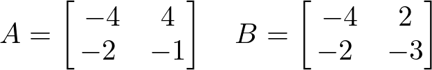
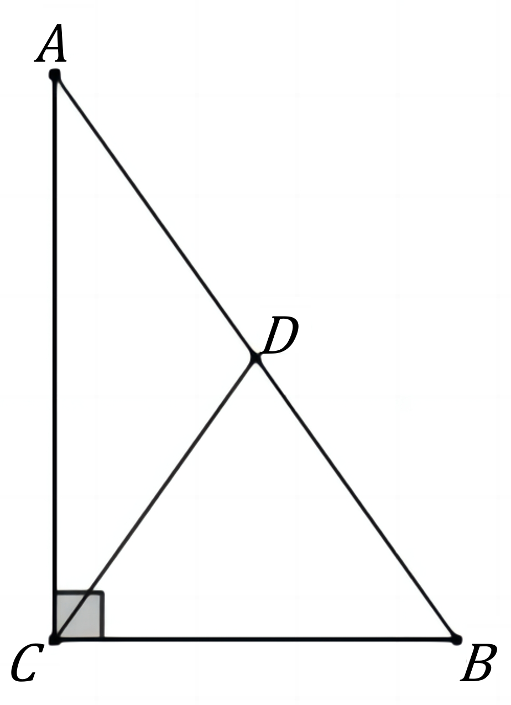

# AVP0834 — Single visual target

DynaMath:475 / DynaMath:38 · different type · Mathematical roles of symbols

## Shared or similar visual information

The letter B

## Evidence locations

- Left image: B before the second bracketed array
- Right image: B at the right endpoint of the horizontal triangle leg

## Mathematical meanings

Left image: The symbol "B" names the matrix whose entries follow in brackets. Right image: The symbol "B" names a specific geometric point at the indicated location.

## Same mathematical meanings

no

## Rationales

The left occurrence is B before the second bracketed array. The right occurrence is B at the right endpoint of the horizontal triangle leg. The left placement shows that the symbol names the matrix whose entries follow in brackets, while the right placement shows that it names a specific geometric point at the indicated location.

Only the selected target is annotated. AI visual-review draft; not independently double-annotated by humans.
