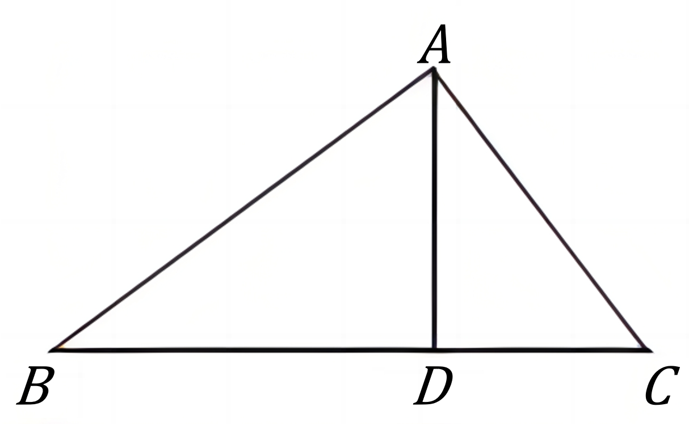
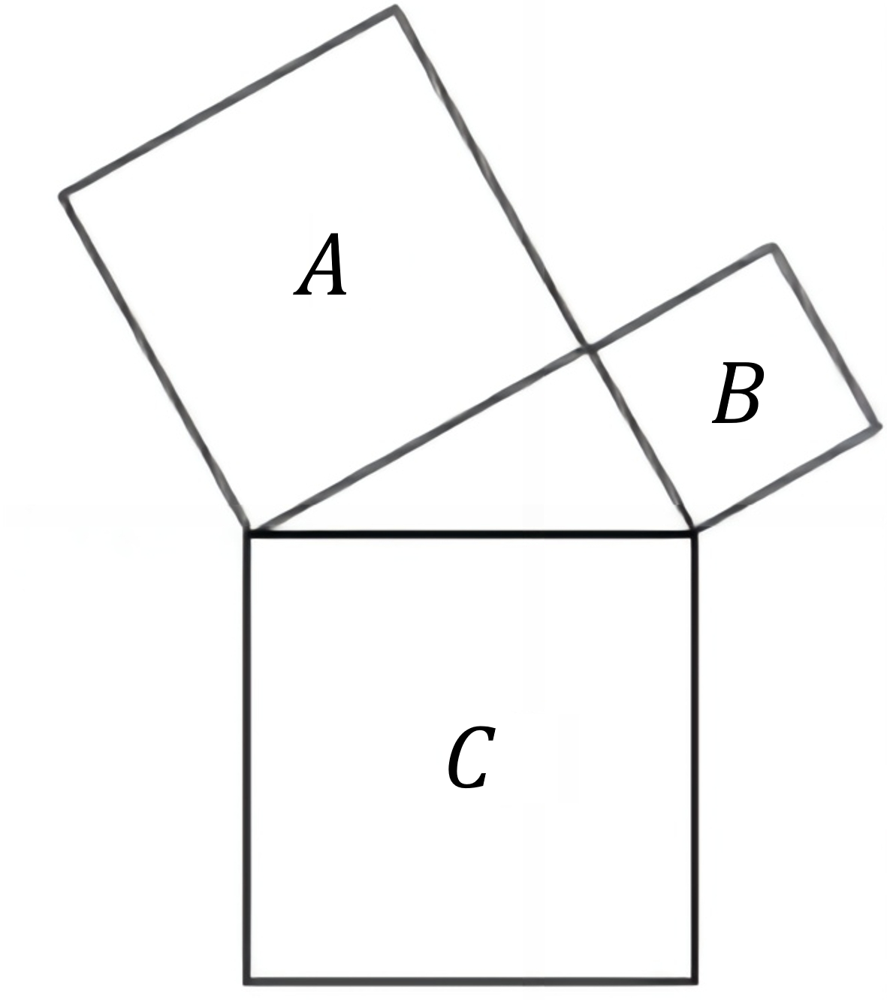

# AVP0835 — Single visual target

DynaMath:45 / DynaMath:85 · same type · Mathematical roles of symbols

## Shared or similar visual information

The letter B

## Evidence locations

- Left image: B at the left endpoint of the triangle base
- Right image: B inside the smaller tilted square on the triangle's right side

## Mathematical meanings

Left image: The symbol "B" names a specific geometric point at the indicated location. Right image: The symbol "B" names the indicated square region.

## Same mathematical meanings

no

## Rationales

The left occurrence is B at the left endpoint of the triangle base. The right occurrence is B inside the smaller tilted square on the triangle's right side. The left placement shows that the symbol names a specific geometric point at the indicated location, while the right placement shows that it names the indicated square region.

Only the selected target is annotated. AI visual-review draft; not independently double-annotated by humans.
