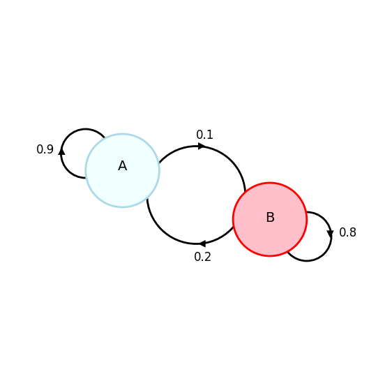
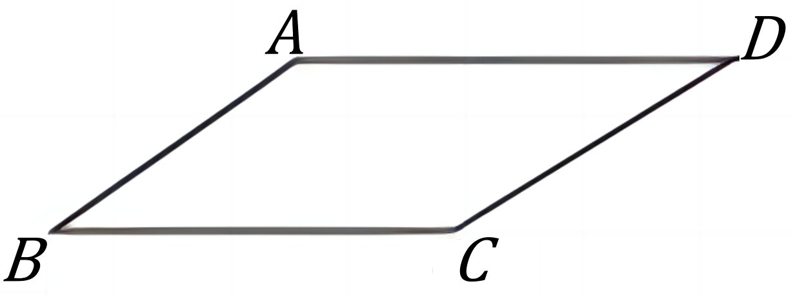

# AVP0836 — Single visual target

DynaMath:72 / DynaMath:49 · different type · Mathematical roles of symbols

## Shared or similar visual information

The letter B

## Evidence locations

- Left image: B inside the red node with a self-loop labeled 0.8
- Right image: B at the lower-left parallelogram corner

## Mathematical meanings

Left image: The symbol "B" names a state with directed probability transitions. Right image: The symbol "B" names a specific geometric point at the indicated location.

## Same mathematical meanings

no

## Rationales

The left occurrence is B inside the red node with a self-loop labeled 0.8. The right occurrence is B at the lower-left parallelogram corner. The left placement shows that the symbol names a state with directed probability transitions, while the right placement shows that it names a specific geometric point at the indicated location.

Only the selected target is annotated. AI visual-review draft; not independently double-annotated by humans.
