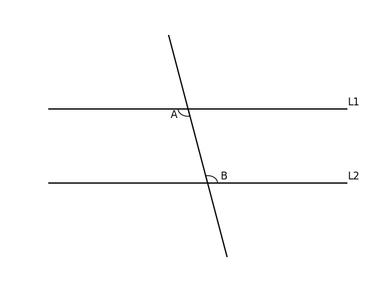

# AVP0837 — Single visual target

DynaMath:55 / DynaMath:182 · same type · Mathematical roles of symbols

## Shared or similar visual information

The letter B

## Evidence locations

- Left image: B at the right intersection of the circle and horizontal axis
- Right image: B beside the arc above the lower parallel line

## Mathematical meanings

Left image: The symbol "B" names a specific geometric point at the indicated location. Right image: The symbol "B" names the angle singled out by the arc.

## Same mathematical meanings

no

## Rationales

The left occurrence is B at the right intersection of the circle and horizontal axis. The right occurrence is B beside the arc above the lower parallel line. The left placement shows that the symbol names a specific geometric point at the indicated location, while the right placement shows that it names the angle singled out by the arc.

Only the selected target is annotated. AI visual-review draft; not independently double-annotated by humans.
