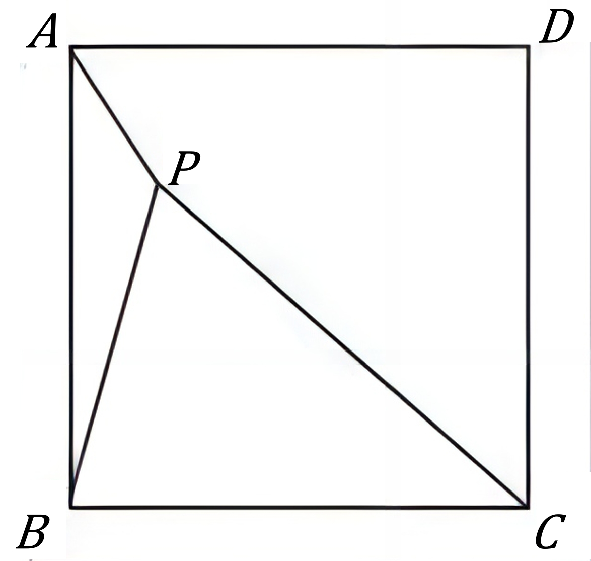
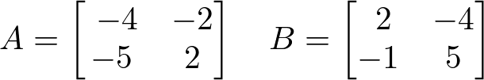

# AVP0838 — Single visual target

DynaMath:145 / DynaMath:488 · different type · Mathematical roles of symbols

## Shared or similar visual information

The letter B

## Evidence locations

- Left image: B at the lower-left endpoint of segment BP
- Right image: B before the second 2 by 2 array, whose first row is 2, -4

## Mathematical meanings

Left image: The symbol "B" names a specific geometric point at the indicated location. Right image: The symbol "B" names the matrix whose entries follow in brackets.

## Same mathematical meanings

no

## Rationales

The left occurrence is B at the lower-left endpoint of segment BP. The right occurrence is B before the second 2 by 2 array, whose first row is 2, -4. The left placement shows that the symbol names a specific geometric point at the indicated location, while the right placement shows that it names the matrix whose entries follow in brackets.

Only the selected target is annotated. AI visual-review draft; not independently double-annotated by humans.
