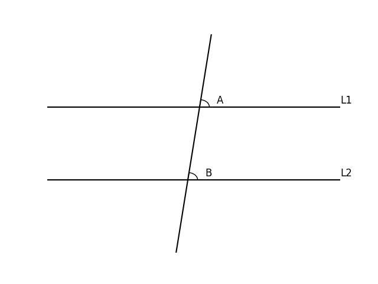
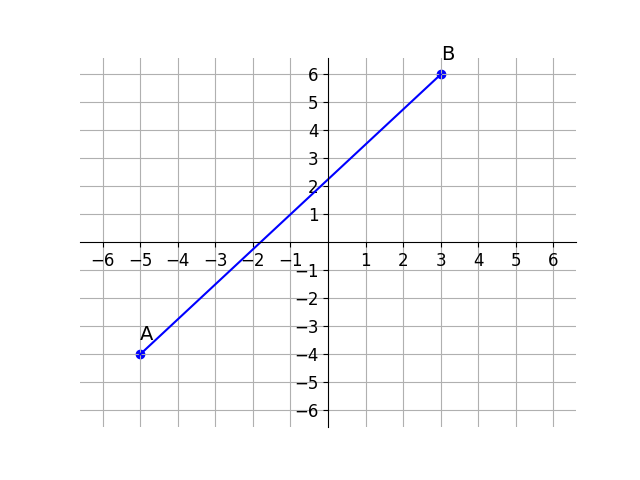

# AVP0839 — Single visual target

DynaMath:184 / DynaMath:135 · same type · Mathematical roles of symbols

## Shared or similar visual information

The letter B

## Evidence locations

- Left image: B beside the acute-angle arc on the lower parallel line
- Right image: B beside the upper-right endpoint of the plotted segment

## Mathematical meanings

Left image: The symbol "B" names the angle singled out by the arc. Right image: The symbol "B" names a specific geometric point at the indicated location.

## Same mathematical meanings

no

## Rationales

The left occurrence is B beside the acute-angle arc on the lower parallel line. The right occurrence is B beside the upper-right endpoint of the plotted segment. The left placement shows that the symbol names the angle singled out by the arc, while the right placement shows that it names a specific geometric point at the indicated location.

Only the selected target is annotated. AI visual-review draft; not independently double-annotated by humans.
