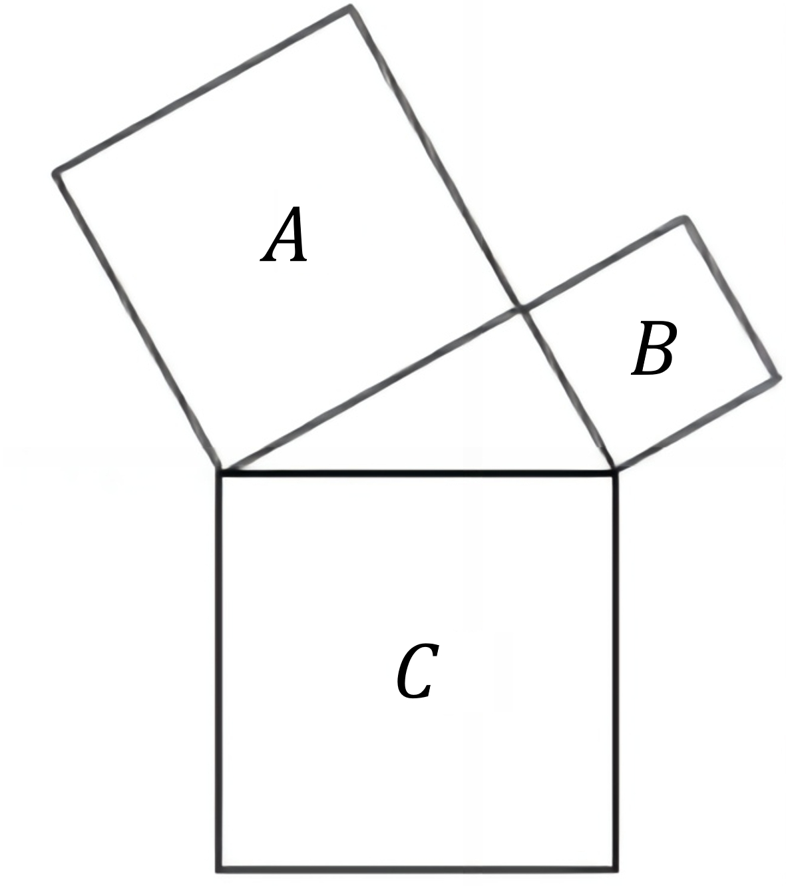
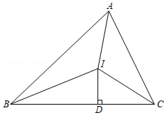

# AVP0840 — Single visual target

DynaMath:85 / DynaMath:13 · same type · Mathematical roles of symbols

## Shared or similar visual information

The letter C

## Evidence locations

- Left image: C inside the large lower square
- Right image: C at the right endpoint of the base

## Mathematical meanings

Left image: The symbol "C" names the indicated square region. Right image: The symbol "C" names a specific geometric point at the indicated location.

## Same mathematical meanings

no

## Rationales

The left occurrence is C inside the large lower square. The right occurrence is C at the right endpoint of the base. The left placement shows that the symbol names the indicated square region, while the right placement shows that it names a specific geometric point at the indicated location.

Only the selected target is annotated. AI visual-review draft; not independently double-annotated by humans.
