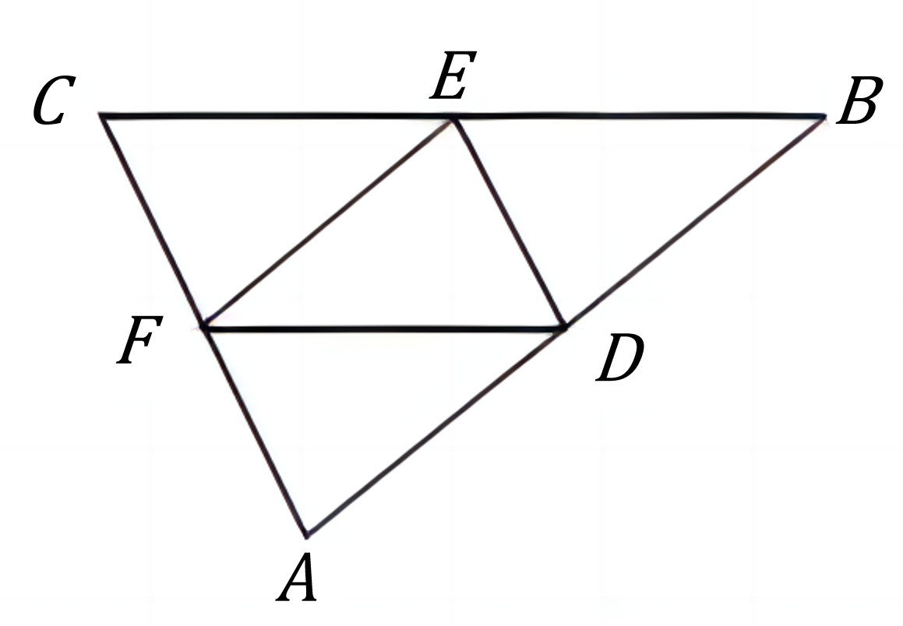
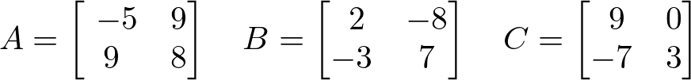

# AVP0841 — Single visual target

DynaMath:24 / DynaMath:491 · different type · Mathematical roles of symbols

## Shared or similar visual information

The letter C

## Evidence locations

- Left image: C at the left endpoint of the top side
- Right image: C before the rightmost array, whose first row is 9, 0

## Mathematical meanings

Left image: The symbol "C" names a specific geometric point at the indicated location. Right image: The symbol "C" names the matrix whose entries follow in brackets.

## Same mathematical meanings

no

## Rationales

The left occurrence is C at the left endpoint of the top side. The right occurrence is C before the rightmost array, whose first row is 9, 0. The left placement shows that the symbol names a specific geometric point at the indicated location, while the right placement shows that it names the matrix whose entries follow in brackets.

Only the selected target is annotated. AI visual-review draft; not independently double-annotated by humans.
