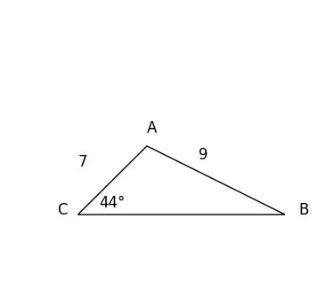
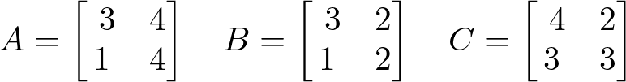

# AVP0842 — Single visual target

DynaMath:207 / DynaMath:478 · different type · Mathematical roles of symbols

## Shared or similar visual information

The letter C

## Evidence locations

- Left image: C next to the lower-left vertex with the 44° angle
- Right image: C before the rightmost 2 by 2 matrix

## Mathematical meanings

Left image: The symbol "C" names a specific geometric point at the indicated location. Right image: The symbol "C" names the matrix whose entries follow in brackets.

## Same mathematical meanings

no

## Rationales

The left occurrence is C next to the lower-left vertex with the 44° angle. The right occurrence is C before the rightmost 2 by 2 matrix. The left placement shows that the symbol names a specific geometric point at the indicated location, while the right placement shows that it names the matrix whose entries follow in brackets.

Only the selected target is annotated. AI visual-review draft; not independently double-annotated by humans.
