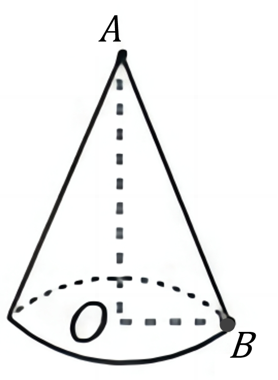
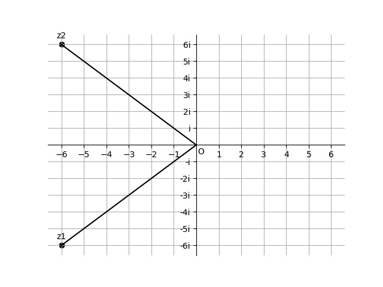

# AVP0843 — Single visual target

DynaMath:8 / DynaMath:338 · different type · Mathematical roles of symbols

## Shared or similar visual information

The letter O

## Evidence locations

- Left image: O at the internal junction of the dashed height and base radius
- Right image: O where the real and imaginary axes cross

## Mathematical meanings

Left image: The symbol "O" marks the center of the indicated circle. Right image: The symbol "O" marks the origin at the intersection of the coordinate axes.

## Same mathematical meanings

no

## Rationales

The left occurrence is O at the internal junction of the dashed height and base radius. The right occurrence is O where the real and imaginary axes cross. The left placement shows that the symbol marks the center of the indicated circle, while the right placement shows that it marks the origin at the intersection of the coordinate axes.

Only the selected target is annotated. AI visual-review draft; not independently double-annotated by humans.
