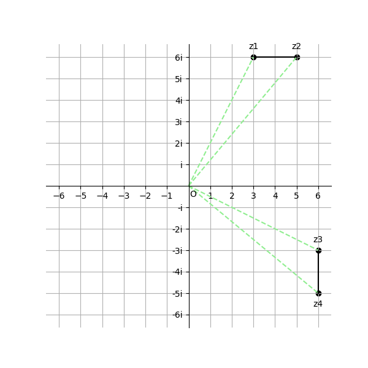
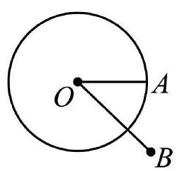

# AVP0844 — Single visual target

DynaMath:339 / MV-MATH:210_1 · same type · Mathematical roles of symbols

## Shared or similar visual information

The letter O

## Evidence locations

- Left image: O at the common start of the dotted rays on the complex plane
- Right image: O next to the interior point from which the radius OA extends

## Mathematical meanings

Left image: The symbol "O" marks the origin at the intersection of the coordinate axes. Right image: The symbol "O" marks the center of the indicated circle.

## Same mathematical meanings

no

## Rationales

The left occurrence is O at the common start of the dotted rays on the complex plane. The right occurrence is O next to the interior point from which the radius OA extends. The left placement shows that the symbol marks the origin at the intersection of the coordinate axes, while the right placement shows that it marks the center of the indicated circle.

Only the selected target is annotated. AI visual-review draft; not independently double-annotated by humans.
